<div align="center">

<!-- Animated Futuristic Header Banner -->


<!-- Live Typing Subtitle -->
<a href="#">
  
</a>

<br/>

<!-- Status & Tech Badges -->


-10b981?style=for-the-badge)

</div>

---

## 🎯 Problem Statement & Motivation

Every academic year, approximately **1 in 6 (~16.7%)** Final Year Project (FYP) groups end with a failed or carried-over outcome. By the time final defense exposes the failure, intervention is impossible.

Because of this class imbalance, a naive majority classifier predicting `"No Risk"` achieves **~84% accuracy** with **0.0% Recall**—failing to rescue a single struggling team.

**FYP-Pulse** is a strictly **Week-8 decision-support cockpit** built solely on the provided cohort CSV (zero external datasets, zero paid APIs). It identifies high-risk groups halfway through the timeline, explains *why* they are at risk, audits subgroup fairness, prioritizes a coordinator's weekly capacity, and simulates actionable interventions live.

---

## 🏗️ End-to-End System Architecture

```mermaid
flowchart LR
    A["Dirty Cohort CSV"] --> B["Forensic Cleaning Engine<br>Dedup - Alias Map - Pair Swap"]
    B --> C["Leakage-Free 80-20<br>Stratified Split"]
    C --> D["Domain Feature<br>Engineering"]
    D --> E["Iterative BayesianRidge<br>MICE Imputer"]
    E --> F["4-Model Stratified CV Arena<br>LR - RF - HistGB - Calibrated Ensemble"]
    F --> G["OOF Threshold and<br>Monotonic Tier Calibration"]
    G --> H["FastAPI Engine"]
    H --> I["3D WebGL Mission Control<br>A1-A7 Live Cockpit"]
```



---

## 📐 Mathematical Foundations

### 1. Forensic Data Recovery & Iterative MICE Imputation (A1)
Rather than naive median imputation or destructive clipping, FYP-Pulse enforces exact domain invariants before probabilistic recovery:

* **Swapped CGPA Detection:** When both $c_{\text{avg}}, c_{\text{min}} \in [0, 4]$ and $c_{\text{min}} > c_{\text{avg}}$, the reversed entry pair is swapped rather than clipped, preserving team academic variance.
* **Solo-Group Identity:** For $n_{\text{size}} = 1$, exact recovery enforces $c_{\text{min}} \equiv c_{\text{avg}}$.
* **Multivariate Imputation by Chained Equations (MICE):** Missing and out-of-range numeric cells are estimated strictly inside training folds via iterative **Bayesian Ridge Regression**:

```math
\hat{x}_{i,j}^{(t)} = \mathbb{E}\left[x_{i,j} \;\middle|\; \mathbf{x}_{i,-j}^{(t-1)},\, \boldsymbol{\theta}_j\right], \qquad \boldsymbol{\theta}_j \sim \mathcal{N}\left(\mathbf{0}, \lambda^{-1}\mathbf{I}\right)
```

---

### 2. Domain Feature Engineering (A2 & A3)
Using strictly Week-8 observable variables (excluding post-Week-8 leakage columns `final_defense_score` and `extension_grant`), we construct six high-signal features:

| Engineered Feature | Mathematical Formulation | Domain Rationale |
| :--- | :--- | :--- |
| **CGPA Disparity Gap** | $g_{\text{cgpa}} = \max(0,\; c_{\text{avg}} - c_{\text{min}})$ | Captures internal *weakest-link / free-rider* academic imbalance hidden by raw average GPA. |
| **Supervision Bandwidth** | $b_{\text{sup}} = \dfrac{m_{\text{8wk}}}{\max(1,\, a_{\text{sup}})}$ | Measures true mentorship attention per active supervised group. |
| **Log Commit Velocity** | $v_{\text{git}} = \ln\!\left(1 + \dfrac{k_{\text{commits}}}{\max(1,\, n_{\text{size}})}\right)$ | Normalizes heavy-tailed GitHub activity per student member. |
| **Approval Delay Ratio** | $r_{\text{delay}} = \dfrac{w_{\text{approval}}}{8}$ | Fraction of the first 8 weeks consumed prior to proposal approval. |
| **Proposal Friction** | $f_{\text{prop}} = r_{\text{revisions}} \cdot w_{\text{approval}}$ | Interaction capturing early scoping instability. |
| **Cyclical Seasonality** | $\left(\sin\frac{2\pi m}{12},\; \cos\frac{2\pi m}{12}\right)$ | Encodes intake calendar periodicity without raw timestamp overfitting. |

---

### 3. Imbalance-Aware Ensemble, Platt Calibration & OOF Thresholding (A3 & A4)
We train **4 distinct model families** under 5-Fold Stratified Cross-Validation with inverse class-frequency weighting:
1. $L_2$-Regularized Logistic Regression
2. Balanced-Subsample Random Forest
3. Class-Weighted Histogram Gradient Boosting (`HistGradientBoostingClassifier`)
4. **Platt-Calibrated Soft-Voting Ensemble**

Tree ensembles and class-weighted classifiers distort raw posterior probabilities. We apply **Platt Sigmoid Calibration** to produce well-calibrated risk probabilities $\hat{p} \in [0, 1]$, audited by **Brier Score**:

```math
\hat{p}(y = 1 \mid s) = \frac{1}{1 + \exp(A s + B)}, \qquad \text{BS} = \frac{1}{N}\sum_{i=1}^{N}(\hat{p}_i - y_i)^2
```

To prevent test-set leakage, the decision threshold $\tau^*$ is optimized exclusively on **Out-of-Fold (OOF)** validation probabilities maximizing $F_1$ with an early-warning Recall tie-breaker:

```math
\tau^* = \arg\max_{\tau \in [0.15,\, 0.80]} \Big( F_1(\tau) + 0.03 \cdot \text{Recall}(\tau) \Big)
```

Risk tier cut-offs $(\tau_{\text{low}}, \tau_{\text{high}})$ are verified on the held-out test set to guarantee **strict empirical monotonicity**:

```math
\widehat{P}(Y=1 \mid \text{Low}) \;<\; \widehat{P}(Y=1 \mid \text{Medium}) \;<\; \widehat{P}(Y=1 \mid \text{High})
```

---

### 4. Exact Interventional Local Explainability (A5)
For any evaluated FYP group $\mathbf{x}$, feature $j$'s signed probability attribution $\phi_j(\mathbf{x})$ is computed via exact interventional marginalization over a stratified training background distribution $\mathcal{B}$—automatically propagating changes through all coupled engineered features:

```math
\phi_j(\mathbf{x}) = f(\mathbf{x}) - \frac{1}{|\mathcal{B}|}\sum_{\mathbf{b} \in \mathcal{B}} f\left(\mathbf{x}_{\setminus j},\, b_j\right)
```

* $\phi_j(\mathbf{x}) > 0 \implies$ **Increases risk** (Crimson indicator)
* $\phi_j(\mathbf{x}) < 0 \implies$ **Decreases risk** (Emerald indicator)
* The highest risk-increasing driver maps directly to a concrete coordinator intervention playbook.

---

### 5. Statistical Fairness Audit: Wilson CIs & Z-Test (A5)
Subgroup disparities across **Leader Gender** and **Campuses with $n \ge 30$ test groups** are evaluated with exact **Wilson 95% Confidence Intervals** and a two-proportion $Z$-test computed via the Gaussian error function $\mathrm{erf}(\cdot)$:

```math
\text{CI}_{0.95} = \frac{\hat{p} + \frac{z^2}{2n} \pm z\sqrt{\frac{\hat{p}(1-\hat{p})}{n} + \frac{z^2}{4n^2}}}{1 + \frac{z^2}{n}}
```

```math
p = 2\left(1 - \frac{1}{2}\left[1 + \mathrm{erf}\left(\frac{|Z|}{\sqrt{2}}\right)\right]\right)
```

---

### 6. Coordinator Capacity Watchlist & What-If Sensitivity (A6 & A7)
* **Weekly Watchlist Lift ($K \in [10, 100]$):**

```math
\text{Precision}@K = \frac{\text{TP}_K}{K}, \qquad \mathbb{E}[\text{Random Hits}] = K \cdot \bar{y}_{\text{test}}, \qquad \text{Lift}@K = \frac{\text{TP}_K}{K \cdot \bar{y}_{\text{test}}}
```

* **Bounded Counterfactual Lever Search (A7):** Immutable attributes (`campus`, `program`, `leader_gender`, historical `CGPA`) are strictly locked. The *"Find Best Lever"* solver evaluates $\Delta \hat{p}_\ell = f(\mathbf{x} \oplus \ell^*) - f(\mathbf{x})$ across actionable levers only, accompanied by an explicit **Association $\neq$ Causation** notice.

---

## ✅ Rubric Coverage Matrix (A1 – A7)

| Task | Level | Implemented Capabilities | Status |
| :---: | :---: | :--- | :---: |
| **A1** | Core | Forensic cleaning, deduplication, alias standardization, range validation, CGPA swap & solo identity rules, MICE imputation, full per-column & per-rule audit tables | ✅ |
| **A2** | Core | 5 interactive dark-neon Plotly dashboards (Team, Supervisor, Project Context + 2 Engineered Features) with 1-line insights & feature explanations | ✅ |
| **A3** | Core | Explicit post-Week-8 dropped-feature table, 4-model stratified CV arena, Accuracy/Precision/Recall/F1/ROC-AUC/Brier/Threshold, all 4 Confusion Matrices & model justification | ✅ |
| **A4** | Core | Week-8 prediction form with live 3D specular tilt risk card, exact probability, color-coded tier badge (Green/Yellow/Red), cut-offs & monotonic test-set rate proof | ✅ |
| **A5** | Core | Top 3 signed local risk drivers, plain-English explanation, targeted support step, Gender & Campus ($\ge 30$) fairness audit with Wilson 95% CIs & statistical takeaway | ✅ |
| **A6** | Bonus | Interactive capacity slider $K \in [10, 100]$, ranked test watchlist, captured TP count, Precision@K, Random baseline, AI Lift multiplier & 1-click CSV export | ✅ |
| **A7** | Bonus | Actionable-only What-If sliders, locked immutable attributes, live Before/After comparison, **Find Best Lever** optimizer & visible Association $\neq$ Causation banner | ✅ |

---

## 📁 Project Structure

```text
fyp-pulse/
├── fyp_pulse_train.csv   # Competition cohort CSV (auto-detected on startup)
├── ml_engine.py          # Cleaning, MICE, FE, 4-Model CV Arena, Attribution, Fairness, A6 & A7
├── main.py               # FastAPI server + REST endpoints + CSV export
├── static/
│   └── index.html        # 3D Three.js Neural Cockpit + Tailwind + Plotly.js SPA
├── requirements.txt      # Zero-compilation lightweight dependencies
└── render.yaml           # 1-click Render.com Blueprint configuration
```

---

## ⚡ Quick Start (Local)

```bash
# 1. Create & activate virtual environment
python3 -m venv venv
source venv/bin/activate        # macOS / Linux
# venv\Scripts\activate         # Windows

# 2. Install lightweight pre-built dependencies (~20 seconds)
pip install -r requirements.txt

# 3. Launch the 3D Mission Control Cockpit
uvicorn main:app --reload
```

Open **`http://127.0.0.1:8000`** in your browser. Any `.csv` file in the root directory is auto-ingested on startup, or you can drag-and-drop a new CSV directly in the top bar.

---

## 🚀 Deploy to Render (Free Tier)

1. Push this repository (including your `.csv` file) to GitHub.
2. On **[Render.com](https://render.com)** → **New +** → **Blueprint** → select your repository.
3. Render automatically reads `render.yaml`:
   * **Build Command:** `pip install -r requirements.txt`
   * **Start Command:** `uvicorn main:app --host 0.0.0.0 --port $PORT`

---

## 🔒 Competition Compliance

> **100% Self-Contained:** This application relies **solely on the provided competition CSV file**. No external datasets, third-party model endpoints, or paid API keys are used anywhere in the system.

<div align="center">
  
</div>
